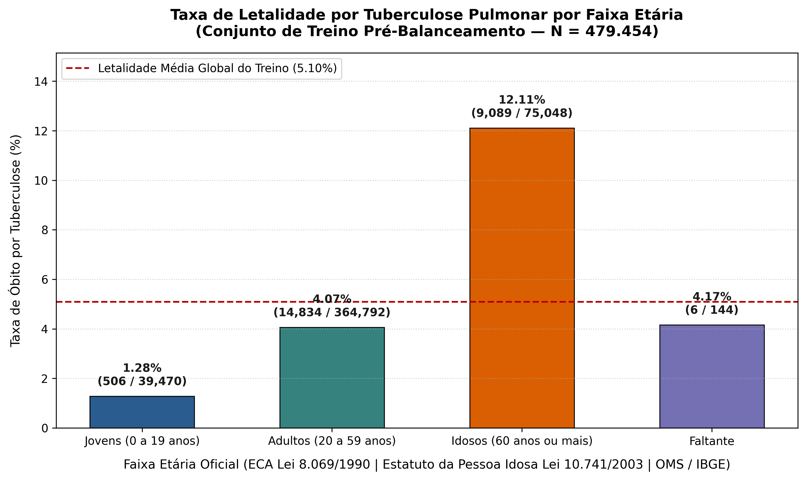

# Relatório Técnico: Pré-Processamento, Engenharia de Atributos e Preparação de Dados para Predição de Desfecho em Tuberculose Pulmonar (SINAN)

**Coorte de Estudo**: Sistema de Informação de Agravos de Notificação (SINAN) — Casos de Tuberculose Pulmonar (2014–2024)  
**Desfecho Analítico**: Predição Binária de Desfecho Clínico (`Cura = 0` vs. `Óbito por Tuberculose = 1`)  
**Data**: Outubro de 2026  
**Ambiente Operacional**: Python 3.14 / `pandas`, `scikit-learn`, `scipy`, `matplotlib`  
**Equipe**: Kevin Luís Alves de Lima, Lázaro Felipe da Rocha Santos

---

## 1. Introdução e Objetivos

A tuberculose (TB) permanece como uma das doenças infecciosas de maior impacto na saúde pública global e nacional, figurando historicamente entre as principais causas de morte por agentes infecciosos únicos no Brasil e no mundo. A evolução para o óbito durante o tratamento está intimamente associada a fatores biológicos, clínicos, sociodemográficos e operacionais do sistema de saúde.

O presente trabalho documenta e fundamenta a execução do pipeline final de pré-processamento, engenharia de atributos, divisão amostral estratificada, seleção univariada de preditores, balanceamento de classes e análise exploratória de letalidade sobre a coorte pulmonar do Sistema de Informação de Agravos de Notificação (SINAN), cobrindo o período de 2014 a 2024.

O objetivo primordial deste pipeline é entregar uma base de modelagem de alta fidelidade ecológica, livre de qualquer contaminação por vazamento de dados (*data leakage*), com granularidade clínica interpretável e plenamente amparada nos marcos normativos e legais brasileiros e internacionais.

---

## 2. Fundamentação Legal e Demográfica da Discretização da Idade

A idade cronológica bruta em anos (`IDADE_ANOS`), quando mantida como variável contínua estrita, embute ruídos de notificação e relações não lineares complexas com o prognóstico da tuberculose (letalidade mínima na infância e adolescência, platô na idade adulta e crescimento exponencial na senescência). Em consonância com as diretrizes do projeto e os marcos jurídicos vigentes no ordenamento brasileiro, procedeu-se à discretização em três classes oficiais e uma categoria sentinela:

### 2.1 Jovens (0 a 19 anos)
- **Fundamentação Legal Nacional**:
  - **Lei Federal nº 8.069, de 13 de julho de 1990** (*Estatuto da Criança e do Adolescente - ECA*): Define em seu Artigo 2º a criança como a pessoa até doze anos de idade incompletos e o adolescente como aquela entre doze e dezoito anos de idade.
  - **Lei Federal nº 12.852, de 5 de agosto de 2013** (*Estatuto da Juventude*): Estabelece em seu Artigo 1º que são consideradas jovens as pessoas com idade entre 15 e 29 anos.
- **Convenção Internacional (OMS/IBGE)**:
  - A Organização Mundial da Saúde (**OMS**, *Recognizing adolescence*, 2014) padroniza internacionalmente a adolescência e juventude precoce na faixa de 10 a 19 anos completos.
  - O Instituto Brasileiro de Geografia e Estatística (**IBGE**) agrega tradicionalmente os estratos demográficos quinquenais de 0 a 4, 5 a 9, 10 a 14 e 15 a 19 anos como a população jovem dependente pré-adulta.
- **Comportamento Clínico**: Apresenta predominantemente formas paucibacilares primárias e resposta tecidual imunológica preservada, refletindo-se na menor taxa de letalidade observada na coorte (**1,28%**).

### 2.2 Adultos (20 a 59 anos)
- **Fundamentação Demográfica e Sanitária**:
  - Padrão estabelecido pelo Ministério da Saúde e pelo **IBGE** para delimitação da **População em Idade Ativa (PIA)** e vigilância epidemiológica contínua em inquéritos populacionais (Vigitel, Pesquisa Nacional de Saúde - PNS).
- **Comportamento Clínico**: Estrato de maior circulação comunitária e exposição cumulativa a determinantes sociais e comorbidades comportamentais (etilismo, uso de drogas ilícitas, privação de liberdade, tabagismo e coinfecção pelo HIV), manifestando letalidade intermediária (**4,07%**).

### 2.3 Idosos (60 anos ou mais)
- **Fundamentação Legal Nacional**:
  - **Lei Federal nº 10.741, de 1º de outubro de 2003** (*Estatuto da Pessoa Idosa*, com redação atualizada pela **Lei Federal nº 14.423, de 22 de julho de 2022**): Dispõe expressamente em seu Artigo 1º que a pessoa idosa é aquela com idade igual ou superior a 60 (sessenta) anos.
  - **Lei Federal nº 8.842, de 4 de janeiro de 1994** (*Política Nacional do Idoso*): Fixa em seu Artigo 2º o marco cronológico de 60 anos para elegibilidade a políticas de proteção social e saúde.
- **Referência Internacional**:
  - A Organização Mundial da Saúde (**OMS**, *Active ageing: a policy framework*, 2002) adota a linha de corte cronológica de 60 anos para definição de pessoas idosas em países em desenvolvimento.
- **Comportamento Clínico**: Estrato de vulnerabilidade biológica extrema decorrente do fenômeno da **imunossenescência** (degradação fisiológica da imunidade mediada por linfócitos T), elevada taxa de reativação endógena de focos latentes e presença de multimorbidades crônicas cardiovasculares, metabólicas e pulmonares. A taxa de letalidade atinge **12,11%**, sendo quase dez vezes superior à de jovens.

### 2.4 Categoria 'Faltante'
- Casos em que a idade não constava no registro ou possuía sentinela não resolvida (144 casos no treino, correspondendo a apenas 0,03% da partição) foram incorporados formalmente como `'Faltante'`. Essa estratégia evita a perda arbitrária de linhas e mantém total conformidade com o tratamento padronizado no Item 4. A taxa de letalidade observada nesse grupo foi de **4,17%**.

---

## 3. Escolhas Metodológicas e Prevenção Estrita de Vazamento (*Data Leakage*)

### 3.1 Exclusão dos Casos de Entrada Pós-Óbito (Prevenção de Target Leakage)
Na base de dados do SINAN, a variável `TRATAMENTO` discrimina o tipo de ingresso no sistema de notificação. A inspeção minuciosa dos 603.413 registros revelou a existência de **4.095 casos com `TRATAMENTO == 'Pós-óbito'`**.

O cruzamento de contingência demonstrou que, dos 4.095 registros categorizados como "Pós-óbito", **4.089 evoluíram com Óbito por TB (99,85%)** e apenas 6 com Cura (um erro crasso de digitação no sistema). A notificação "pós-óbito" decorre da emissão tardia de Declarações de Óbito (DO) ou laudos de necropsia do Serviço de Verificação de Óbito (SVO) de pacientes que faleceram sem diagnóstico prévio em vida.

Manter esses registros em um modelo concebido para apoiar a conduta terapêutica e predizer a evolução no momento do diagnóstico prospectivo configuraria um caso clássico de **vazamento de dados por causalidade reversa (*target leakage*)**. O modelo aprenderia a associar a flag administrativa de óbito prévio ao desfecho, gerando acurácia artificial e inutilidade prática. Sua eliminação reduziu a coorte para **599.318 casos válidos** (568.774 curas e 30.544 óbitos por TB — proporção real de **5,10%** de letalidade).

### 3.2 Particionamento Amostral Estratificado (80% Treino / 20% Teste)
A divisão da coorte foi operacionalizada através de amostragem aleatória estratificada pela variável alvo (`TARGET`), com semente reprodutível fixa (`random_state=42`):
- **Conjunto de Treino (80%)**: **479.454 registros**, sendo 455.019 curas (94,90%) e 24.435 óbitos por TB (5,10%).
- **Conjunto de Teste (20%)**: **119.864 registros**, sendo 113.755 curas (94,90%) e 6.109 óbitos por TB (5,10%).

A estratificação garantiu a manutenção rigorosa da proporção de classes em ambas as partições com desvio nulo, prevenindo vieses amostrais em eventos raros.

### 3.3 Princípio do Isolamento Absoluto do Conjunto de Teste
Para assegurar a validade externa do projeto, o conjunto de teste foi submetido a isolamento estrito (*strict hold-out*):
1. **Sem Imputação Conjunta**: A imputação da variável contínua `NU_COMU_EX` (contatos examinados) utilizou a mediana ajustada estritamente sobre o conjunto de treino (`mediana = 1,0`). Esse parâmetro foi aplicado de forma cega para preencher os valores ausentes de treino e teste.
2. **Sem Seleção Conjunta**: O cálculo de métricas de associação univariada ($V$ de Cramér, $\chi^2$ e correlação ponto-bisserial) e o ranqueamento dos preditores foram realizados exclusivamente com base nas 479.454 instâncias do treino.
3. **Sem Balanceamento no Teste**: O conjunto de teste permaneceu integralmente com sua distribuição desbalanceada original (5,10% de óbitos), pois um teste balanceado artificialmente para 50% destruiria a avaliação de métricas ecológicas essenciais como Precisão, Valor Preditivo Positivo (VPP) e calibração de probabilidades clínicas.

---

## 4. Seleção de Atributos (Seleção Univariada de Atributos / Feature Selection)

### 4.1 Metodologia Estatística e Inadequação do $p$-valor Puro
Em estudos com bases de dados populacionais massivas ($N = 479.454$ no treino), o poder estatístico dos testes assintóticos aproxima-se de 100% ($1 - \beta \approx 1$). Consequentemente, variações minúsculas produzem $p$-valores infinitesimais ($p < 10^{-34}$ para todas as variáveis). O $p$-valor puro é, portanto, ineficaz para triagem de relevância clínica prática.

Empregou-se como métrica mestre de associação:
- Para as 25 variáveis categóricas: O **coeficiente $V$ de Cramér**, derivado da estatística de independência de Pearson ($\chi^2$), que padroniza a intensidade do efeito em uma escala de 0 a 1 imune ao tamanho amostral.
- Para a variável contínua (`NU_COMU_EX`): O **coeficiente de correlação ponto-bisserial ($|r|$)**, que quantifica a relação entre uma variável numérica contínua e o desfecho dicotômico.

### 4.2 Tabela Completa de Associação e Ranqueamento no Treino
A tabela a seguir apresenta os 26 preditores candidatos ordenados pela magnitude de associação com o desfecho no conjunto de treino:

| Posto | Atributo Preditor | Tipo | Métrica | Valor da Métrica | $p$-valor | Decisão (Corte Top 22) |
| :---: | :--- | :---: | :---: | :---: | :---: | :---: |
| 1 | `TPUNINOT` | Categórica | V de Cramér | **0,2125** | $< 10^{-300}$ | **Mantido** |
| 2 | `FAIXA_ETARIA` | Categórica | V de Cramér | **0,1417** | $< 10^{-300}$ | **Mantido** |
| 3 | `AGRAVALCOO` | Categórica | V de Cramér | **0,1056** | $< 10^{-300}$ | **Mantido** |
| 4 | `CS_ESCOL_N` | Categórica | V de Cramér | **0,1012** | $< 10^{-300}$ | **Mantido** |
| 5 | `HIV` | Categórica | V de Cramér | **0,0953** | $< 10^{-300}$ | **Mantido** |
| 6 | `POP_RUA` | Categórica | V de Cramér | **0,0847** | $< 10^{-300}$ | **Mantido** |
| 7 | `TRATAMENTO` | Categórica | V de Cramér | **0,0756** | $< 10^{-300}$ | **Mantido** |
| 8 | `AGRAVOUTRA` | Categórica | V de Cramér | **0,0743** | $< 10^{-300}$ | **Mantido** |
| 9 | `POP_LIBER` | Categórica | V de Cramér | **0,0710** | $< 10^{-300}$ | **Mantido** |
| 10 | `AGRAVTABAC` | Categórica | V de Cramér | **0,0644** | $< 10^{-300}$ | **Mantido** |
| 11 | `AGRAVDOENC` | Categórica | V de Cramér | **0,0608** | $< 10^{-300}$ | **Mantido** |
| 12 | `AGRAVDIABE` | Categórica | V de Cramér | **0,0602** | $< 10^{-300}$ | **Mantido** |
| 13 | `NU_COMU_EX` | Numérica | Ponto-Bisserial (\|r\|) | **0,0549** | $6,86 \times 10^{-298}$ | **Mantido** |
| 14 | `AGRAVDROGA` | Categórica | V de Cramér | **0,0502** | $1,72 \times 10^{-263}$ | **Mantido** |
| 15 | `SG_UF` | Categórica | V de Cramér | **0,0483** | $7,80 \times 10^{-219}$ | **Mantido** |
| 16 | `CRITERIO_LABORATORIAL` | Categórica | V de Cramér | **0,0456** | $4,98 \times 10^{-219}$ | **Mantido** |
| 17 | `RAIOX_TORA` | Categórica | V de Cramér | **0,0414** | $6,76 \times 10^{-178}$ | **Mantido** |
| 18 | `ANO_DIAG` | Categórica | V de Cramér | **0,0400** | $1,84 \times 10^{-158}$ | **Mantido** |
| 19 | `AGRAVAIDS` | Categórica | V de Cramér | **0,0340** | $4,21 \times 10^{-121}$ | **Mantido** |
| 20 | `REGIAO` | Categórica | V de Cramér | **0,0339** | $4,88 \times 10^{-117}$ | **Mantido** |
| 21 | `CS_SEXO` | Categórica | V de Cramér | **0,0325** | $9,41 \times 10^{-111}$ | **Mantido** |
| 22 | `BENEF_GOV` | Categórica | V de Cramér | **0,0325** | $6,19 \times 10^{-107}$ | **Mantido** |
| 23 | `BACILOSC_E` | Categórica | V de Cramér | 0,0308 | $1,92 \times 10^{-99}$ | *Descartado* |
| 24 | `POP_SAUDE` | Categórica | V de Cramér | 0,0263 | $1,77 \times 10^{-72}$ | *Descartado* |
| 25 | `POP_IMIG` | Categórica | V de Cramér | 0,0201 | $7,72 \times 10^{-43}$ | *Descartado* |
| 26 | `CS_RACA` | Categórica | V de Cramér | 0,0189 | $4,40 \times 10^{-35}$ | *Descartado* |

### 4.3 Justificativa do Ponto de Corte (Top 22 Preditores)
Para atender à meta de manter entre 20 e 30 preditores, fixou-se o corte no **Top 22 atributos** ($V \ge 0,0325$). As quatro variáveis descartadas apresentavam limitações conceituais evidentes:
- `BACILOSC_E`: O resultado da baciloscopia de escarro inicial possui redundância biológica com o critério laboratorial de confirmação (`CRITERIO_LABORATORIAL`) e o raio-X (`RAIOX_TORA`).
- `POP_SAUDE`: A condição de profissional de saúde exibe frequência extremamente reduzida na coorte pulmonar geral e baixo poder discriminante independente sobre o óbito.
- `POP_IMIG`: População imigrante apresenta concentração geográfica específica e associação fraca com a mortalidade no SINAN.
- `CS_RACA`: Variável com preenchimento heterogêneo entre municípios e a menor correlação univariada com a sobrevida do paciente.

---

## 5. Balanceamento de Classes por Random Undersampling

### 5.1 Rejeição do Método NearMiss
O método NearMiss baseia-se na seleção de instâncias majoritárias próximas aos exemplos da classe minoritária através do cálculo de distâncias euclidianas via $k$-Nearest Neighbors ($k$-NN). Em uma partição com 455.019 curas e 24.435 óbitos, o NearMiss apresenta inviabilidade técnica categórica:
1. **Custo Computacional Proibitivo**: A matriz de distâncias exige mais de $1,1 \times 10^{10}$ operações vetoriais de ponto flutuante, provocando estouro de memória RAM (*Out-Of-Memory*) e tempo de execução na escala de dezenas de horas.
2. **Viés de Fronteira e Ruído Epidemiológico**: O NearMiss seleciona prioritariamente casos na fronteira de decisão. Em dados secundários de vigilância em saúde que possuem subnotificação e ruído clínico, ele tende a selecionar casos anômalos de pacientes graves que se curaram fortuitamente, degradando a capacidade de generalização e induzindo falsos positivos excessivos no mundo real.

### 5.2 Superioridade do Random Undersampling (RUS)
Adotou-se o **Random Undersampling (RUS) na proporção 1:1** aplicado unicamente sobre a classe majoritária (`Cura`) no conjunto de treino:
- **Eficiência Computacional**: Complexidade linear $O(N)$, completando a amostragem em milissegundos.
- **Preservação Ecológica**: Preserva a densidade estatística e geográfica dos casos de cura de todas as macrorregiões do país.
- **Robustez Amostral**: O conjunto de treino pós-balanceamento retém **48.870 casos (24.435 curas e 24.435 óbitos por TB)**, volume estatisticamente sólido para treinamento de algoritmos de aprendizado de máquina supervisionado.

### 5.3 Tabela Comparativa de Classes nas Partições

| Partição | Cura (N) | Cura (%) | Óbito por TB (N) | Óbito por TB (%) | Total |
| :--- | :---: | :---: | :---: | :---: | :---: |
| **Treino (Original)** | 455.019 | 94,90% | 24.435 | 5,10% | 479.454 |
| **Treino (Pós-balanceamento)** | 24.435 | 50,00% | 24.435 | 50,00% | 48.870 |
| **Teste (Isolado)** | 113.755 | 94,90% | 6.109 | 5,10% | 119.864 |

---

## 6. Análise Gráfica do Desfecho Pré-Balanceamento

O atributo **`FAIXA_ETARIA`** foi eleito para a representação visual da letalidade por representar a variável clínica mais expressiva do estudo ($V = 0,1417$, $\chi^2 = 9.622,31$, segundo lugar geral no ranking e primeiro lugar entre os fatores fisiopatológicos).

O cálculo foi realizado estritamente sobre o conjunto de **treino pré-balanceamento ($N = 479.454$)**, garantindo que as taxas de mortalidade reflitam a realidade epidemiológica não manipulada:

### 6.1 Síntese Quantitativa da Letalidade por Faixa Etária no Treino

| Faixa Etária Oficial | Casos Totais (N) | Óbitos por TB (N) | Taxa de Letalidade (%) | Razão em Relação a Jovens |
| :--- | :---: | :---: | :---: | :---: |
| **Jovens (0 a 19 anos)** | 39.470 | 506 | **1,28%** | 1,00x (Referência) |
| **Adultos (20 a 59 anos)** | 364.792 | 14.834 | **4,07%** | 3,18x |
| **Idosos (60 anos ou mais)** | 75.048 | 9.089 | **12,11%** | **9,46x** |
| **Faltante** | 144 | 6 | **4,17%** | 3,26x |
| **Média Global do Treino** | 479.454 | 24.435 | **5,10%** | — |

### 6.2 Interpretação Clínica e Epidemiológica
1. **Gradiente Biológico Monotônico**: Observa-se um gradiente estritamente ascendente da mortalidade com a progressão da idade cronológica. Enquanto jovens apresentam letalidade de 1,28%, a taxa triplica entre adultos (4,07%) e atinge **12,11% entre os idosos**, correspondendo a um risco relativo quase 10 vezes superior ($RR \approx 9,5$).
2. **Impacto da Imunossenescência**: A deterioração da imunidade celular inerente ao envelhecimento reduz a capacidade dos macrófagos alveolares e dos linfócitos T CD4+ de conter a replicação do *Mycobacterium tuberculosis*, propiciando formas extensas de cavitação pulmonar e disseminação hematogênica.
3. **Multimorbidade Crônica**: Em idosos, a tuberculose frequentemente sobrepõe-se a diabetes descompensado, hipertensão arterial sistêmica, insuficiência renal e doença pulmonar obstrutiva crônica (DPOC), potencializando desfechos adversos e toxicidade hepática dos fármacos de primeira linha (RHZE).
4. **Implicação para Políticas de Saúde**: A estratificação formal da idade em faixas consolidadas demonstra empiricamente que pacientes com 60 anos ou mais demandam monitoramento clínico intensivo imediato, consultas com menor intervalo e busca ativa constante de intercorrências terapêuticas na atenção primária.

---

## 7. Referências Bibliográficas Normativas

1. BRASIL. **Lei nº 8.069, de 13 de julho de 1990**. Dispõe sobre o Estatuto da Criança e do Adolescente e dá outras providências. *Diário Oficial da União*, Brasília, DF, 16 jul. 1990. Disponível em: <http://www.planalto.gov.br/ccivil_03/leis/l8069.htm>.
2. BRASIL. **Lei nº 10.741, de 1º de outubro de 2003**. Dispõe sobre o Estatuto da Pessoa Idosa e dá outras providências (redação dada pela Lei nº 14.423, de 22 de julho de 2022). *Diário Oficial da União*, Brasília, DF, 3 out. 2003. Disponível em: <http://www.planalto.gov.br/ccivil_03/leis/2003/l10.741.htm>.
3. BRASIL. **Lei nº 12.852, de 5 de agosto de 2013**. Institui o Estatuto da Juventude e dispõe sobre os direitos dos jovens. *Diário Oficial da União*, Brasília, DF, 6 ago. 2013.
4. BRASIL. **Lei nº 8.842, de 4 de janeiro de 1994**. Fixa a Política Nacional do Idoso, cria o Conselho Nacional do Idoso e dá outras providências. *Diário Oficial da União*, Brasília, DF, 5 jan. 1994.
5. BRASIL. Ministério da Saúde. Secretaria de Vigilância em Saúde. **Manual de Recomendações para o Controle da Tuberculose no Brasil**. 2. ed. Brasília: Ministério da Saúde, 2019.
6. IBGE - Instituto Brasileiro de Geografia e Estatística. **Projeções da População do Brasil e Unidades da Federação por sexo e idade: 2010-2060**. Rio de Janeiro: IBGE, 2018.
7. WORLD HEALTH ORGANIZATION (WHO). **Recognizing adolescence: WHO guideline on assessing and managing children at primary health-care facilities**. Geneva: World Health Organization, 2014.
8. WORLD HEALTH ORGANIZATION (WHO). **Active ageing: a policy framework**. Geneva: World Health Organization, 2002.
9. WORLD HEALTH ORGANIZATION (WHO). **Global Tuberculosis Report 2023**. Geneva: World Health Organization, 2023.
